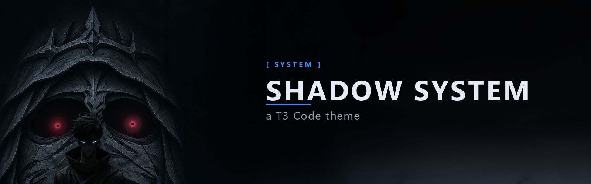
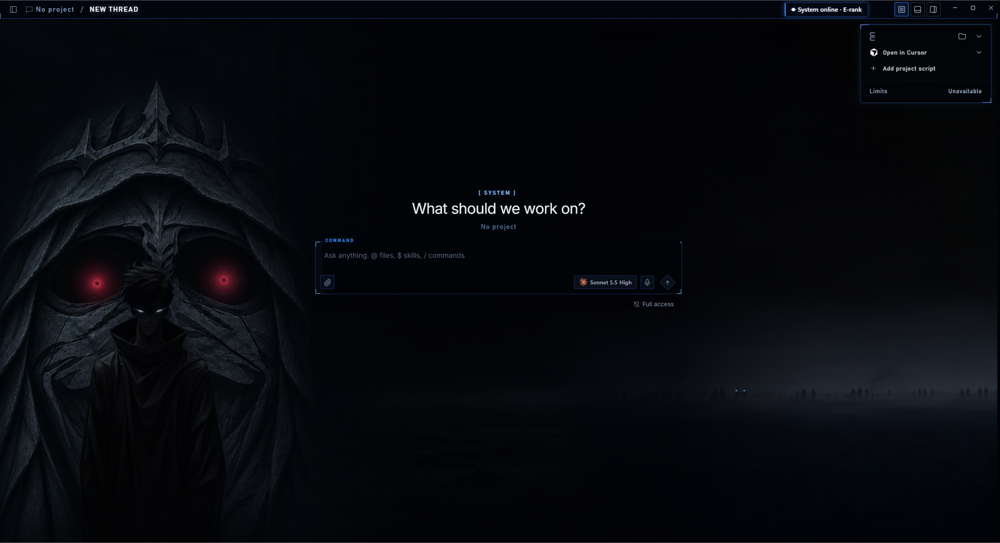
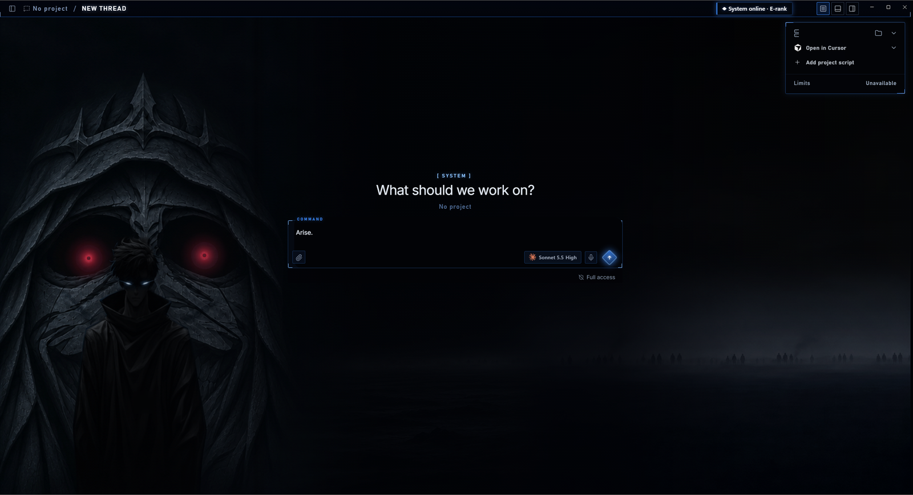
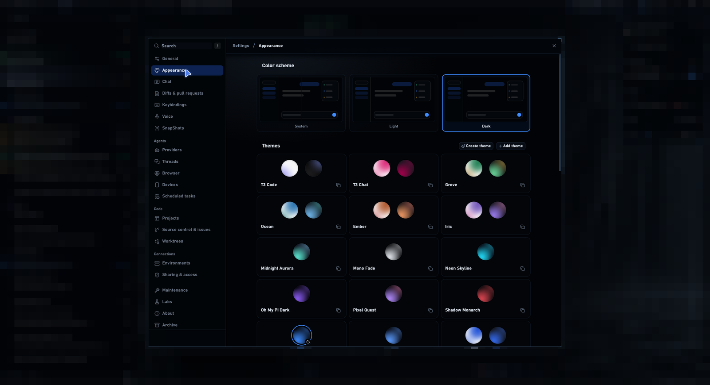

<div align="center">



### An OLED-black "System window" for T3 Code, and it reacts to what your agents are doing.


**[Screenshots](#screenshots)** · **[What reacts](#what-reacts-to-what)** · **[Install](#install)** · **[Customize](#customize)**

</div>

---

**Shadow System** (`shadow-system`) is a dark theme for the T3 Code desktop app, inspired by the blue "System" windows of *Solo Leveling*. Near-black surfaces, one vivid blue accent (no purple anywhere, even project icons are remapped), Segoe UI, and a hooded-figure painting behind the chat.

The art is not just wallpaper. Its glowing eyes, the distant army, the header chip and the usage bars all follow live app state: working, waiting on a question, typing, hovering Send, and how full the context window is.

## Screenshots

<p align="center">
  <br>
  <sub>New thread, idle: hero label, command composer, the hooded figure and the army on the horizon (one soldier is mid-blink).</sub>
</p>

<p align="center">
  <br>
  <sub>Typing a message: the hood's eyes brighten, the small figure's eyes glint, and Send lights up.</sub>
</p>

<p align="center">
  <br>
  <sub>Detail: the same eyes idle (left) and while typing (right).</sub>
</p>

<p align="center">
  <br>
  <sub>Detail: every few seconds one distant soldier opens its eyes.</sub>
</p>

<p align="center">
  <br>
  <sub>Settings, Appearance: where you add and pick themes.</sub>
</p>

> All screenshots are real, unedited app captures except the settings shot, whose background is pixelated.

## What reacts to what

| When this happens | The theme does this |
|---|---|
| **Idle** | The hood's red eyes breathe slowly. Every few seconds one distant soldier opens its eyes. Blue specks drift up the left side (inside threads). |
| **You type a message** | The hood's eyes brighten and the small figure's eyes glint blue. |
| **You hover Send** | The distant army wakes, eyes lighting in a wave outward from the figure. |
| **An agent is working, or a question is waiting** | A heartbeat pulses in the hood's eyes and the whole army stays awake, pulsing with it. The header chip switches to "Quest active" with a scan. The question card itself stays flat and calm. |
| **Context window turns amber or red** | Alert colors on the header chip and meter ("Mana low" at amber, "Penalty zone" at red), and a faster heartbeat. |
| **Context window fills up** | The header chip shows a rank (E-rank up through A-rank and beyond) and the accent steps brighter as the context fills. |
| **Rank changes** | The rank chip plays a one-shot level-up ping. |
| **A turn finishes** | A `[ QUEST COMPLETE ]` label, plus a sweep on Done rows in the sidebar. |
| **Messages, dialogs, toasts** | Assistant messages carry a `[ SYSTEM ]` label, the new-thread hero types its own `[ SYSTEM ]` label, toasts get `[ NOTIFICATION ]`, and dialogs, the command palette and menus **unfold** from a line into a window. |
| **Usage / quota bars** | Blue by default, amber under 10% left, red at 0%. |

## Install

Pick one of two options.

### A. In the app

1. Download `theme/shadow-system.json` and `theme/shadow-system.png`.
2. In T3 Code open **Settings → Appearance → Add theme**, drop in (or paste) the JSON and add it.
3. Put `shadow-system.png` in the themes folder (table below) next to the theme file, named exactly after the theme id: `shadow-system.png`. T3 only loads background images from that folder; it can't be imported through the Add theme box.
4. Under **Themes**, pick **Shadow Monarch: System** for dark mode, and set the color scheme above it to **Dark** (the theme is dark-only). You may need to scroll the grid.

Note: if T3 says the theme is already installed and you choose "Keep both", the copy gets a different id. Rename the PNG to match that id.

### B. Script

`install.ps1` / `install.sh` copy both files into the themes folder.

| OS | Themes folder | Status |
|---|---|---|
| Windows | `%USERPROFILE%\.t3\userdata\themes\` | Confirmed (on a real install, and in the app's server code) |
| macOS | `~/.t3/userdata/themes/` | Likely: the app builds this path from the home directory with no OS-specific branch, but not tested on a Mac |
| Linux | `~/.t3/userdata/themes/` | Likely: same reasoning, not tested on Linux |

If you set the `T3CODE_HOME` environment variable, the base folder moves there. The install scripts honor it.

**Windows (PowerShell):**

```powershell
./install.ps1
```

**macOS / Linux:**

```sh
sh install.sh
```

Both scripts create the folder if it is missing, copy the two files, print what they did, and never delete anything. If a different `shadow-system` file is already there, it is saved as `*.bak` first. Then pick the theme as in step 4 above.

## Customize

Everything lives in `theme/shadow-system.json`:

- `colors`: the native palette (`accent`, `surface`, `sidebar`, `error`, ...). Change `#3d8bff` here to retint the app chrome.
- `css`: extra styling. The main knobs are custom properties on `:root`:

| Property | What it controls |
|---|---|
| `--ac` / `--ac2` | Accent and its lighter companion (`#3d8bff` / `#8cc4ff`) |
| `--acs` / `--acb` / `--acg` | Accent surface, border and glow |
| `--sysfont` | Font stack for the System-style labels (Bahnschrift, then Segoe UI) |
| `--hdr` | Header chip text ("System online") |
| `--army`, `--beat`, `--watch` | Live-state dials the animations read: army awake (0 or 1), heartbeat strength, typing brightness |

Heads-up: the amber and red alert stages and each rank bucket **override** `--ac` on purpose. To change the accent everywhere, find-and-replace the blue hex values (`#3d8bff` and friends) across the whole `css` string rather than editing only the first `:root` rule.

**Swap the art:** replace `theme/shadow-system.png` (installed next to the JSON) with your own image. The theme was composed for **1920x1080**, with the figure at the far left and a quiet, dark right side so the UI stays readable. The eye glows are positioned to the shipped art, so with new art expect to move or remove those layers in the CSS.

Notes for CSS tinkerers: T3 caps a theme's CSS at 100k characters (this one is about 77k), and the CSS here contains no backslashes.

## Performance

- The art is a static background that never repaints.
- The eyes and the army are two small layers, animated in steps (a few repaints per second).
- The specks move on the GPU (transform only).
- No backdrop blur anywhere.
- **Reduced motion is respected:** with the OS "reduce motion" setting on, all animation is off and you get the same look, static.

## Known limits

CSS can't restyle everything:

- The native right-click menu (it is drawn by the OS, not the page).
- Hard-coded strings such as "Open a surface" and "Search...".
- Provider brand colors in the usage cost chart.
- The pull-request page background stays plain black (no styling hook found).
- Specks only show inside threads (the new-thread page has no chat canvas).
- Some effects (toast labels, the Done-row sweep, the amber/red stages on a very long thread) have had less live testing than the rest.

## Credits and disclaimer

- **Code** (the theme CSS/JSON and install scripts): [MIT](LICENSE).
- **Background art** (`theme/shadow-system.png`): AI-generated fan art inspired by *Solo Leveling*. It is **excluded from the MIT grant**, is not affiliated with or endorsed by the rights holders of *Solo Leveling*, and will be removed on request. See [`theme/ART-NOTICE.md`](theme/ART-NOTICE.md).
- "T3 Code" and "Solo Leveling" belong to their respective owners. This is an unofficial community theme.
