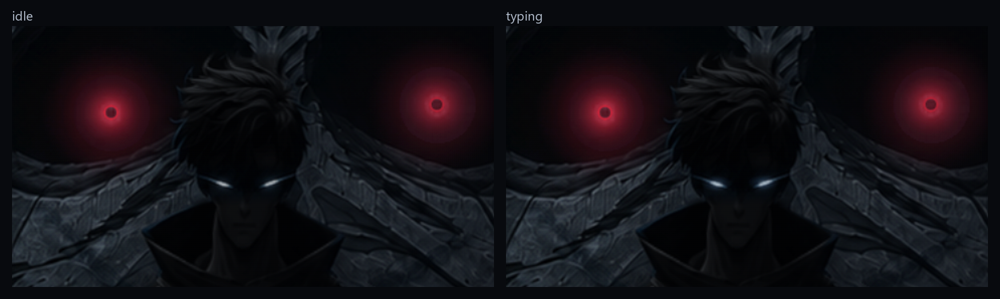
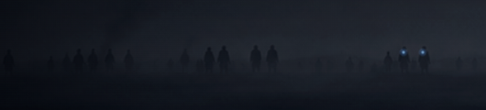

<div align="center">


### An OLED-black "System window" for T3 Code, and it reacts to what your agents are doing.


Made by **[@ArcticSlayy](https://github.com/ArcticSlayy)**

**[Screenshots](#screenshots)** · **[What reacts](#what-reacts-to-what)** · **[Install](#install)** · **[Ask your agent](#or-just-ask-your-t3-agent)** · **[Customize](#customize)**

</div>

---

**Shadow System** (`shadow-system`) is a dark theme for the T3 Code desktop app, inspired by the blue "System" windows of *Solo Leveling*. Near-black surfaces, one vivid blue accent (no purple anywhere, even project icons are remapped), Segoe UI, and a hooded-figure painting behind the chat.

The art is not just wallpaper. Its glowing eyes, the distant army, the header chip and the usage bars all follow live app state: working, waiting on a question, typing, hovering Send, and how full the context window is.

## Screenshots

<p align="center">
  <br>
  <sub>New thread, idle: hero label, command composer, the hooded figure and the army on the horizon.</sub>
</p>

<p align="center">
  <br>
  <sub>Typing a message: the hood's eyes brighten, the small figure's eyes glint, and Send lights up.</sub>
</p>

<p align="center">
  <br>
  <sub>Detail: idle (left) and while typing (right), when the small figure's eyes catch a blue glint.</sub>
</p>

<p align="center">
  <br>
  <sub>Detail: every few seconds one distant soldier opens its eyes.</sub>
</p>

<p align="center">
  <br>
  <sub>Settings, Appearance: where you pick themes.</sub>
</p>

> The two full-window shots are real app captures. The details are crops: the eyes comparison puts two captures side by side, the blink is enlarged from a capture, and the settings shot has its background pixelated.

## What reacts to what

| When this happens | The theme does this |
|---|---|
| **Idle** | The hood's red eyes breathe slowly. Every few seconds one distant soldier opens its eyes. Blue specks drift up the left side (inside threads). |
| **You type a message** | The hood's eyes brighten and the small figure's eyes glint blue. |
| **You hover Send** | The distant army wakes, eyes lighting in a left-to-right wave, outward from the figure. |
| **An agent is working, or a question is waiting** | A heartbeat pulses in the hood's eyes and the whole army stays awake, pulsing with it. The header chip reads "Quest active" (or "Awaiting orders" for a question) and pulses. The question card itself stays flat and calm. |
| **Context window turns amber or red** | Alert colors on the header chip and meter ("Mana low" at amber, "Penalty zone" at red), and a faster heartbeat. |
| **Context window fills up** | The header chip shows a GATE rank: "◆ System online · C-rank Gate" (the state word, then the rank) (0-9% E, 10-24% D, 25-44% C, 45-59% B, 60-74% A, 75-100% S; at T3's red context stage it reads "Red Gate"). |
| **Reasoning effort changes** | The composer's model button shows a rank pill for the current effort (None/Minimal/Off E, Low D, Medium C, High B, Extra High A, Max S, Ultrathink/Ultra MONARCH). Effort menu rows get rank pills, a "laser" underline that grows with rank, and a stepped sheen. |
| **Rank changes** | The rank chip plays a one-shot level-up ping. |
| **A turn finishes** | A `[ QUEST COMPLETE ]` label, plus a sweep on Done rows in the sidebar. |
| **Messages, dialogs, toasts** | Assistant messages carry a `[ SYSTEM ]` label, the new-thread hero types its own `[ SYSTEM ]` label, toasts get `[ NOTIFICATION ]`, and dialogs, the command palette and menus **unfold** from a line into a window. |
| **Usage / quota bars** | Blue by default, amber under 10% left, red at 0%. |

## Install

### One line

Windows (PowerShell)

```powershell
irm https://raw.githubusercontent.com/ArcticSlayy/shadow-system-t3-theme/main/install.ps1 | iex
```

macOS / Linux

```sh
curl -fsSL https://raw.githubusercontent.com/ArcticSlayy/shadow-system-t3-theme/main/install.sh | bash
```

**Requirements.** Use a T3 Code desktop or web build with **Settings → Appearance → Themes**. Theme support is unavailable in the mobile app. The installed theme makes no network requests.

Copy **both** files into T3 Code's themes folder, then pick the theme.

> **Don't use Settings → Add theme for this one.** T3 doesn't load background images for themes imported through that box, so you'd get the colors without the art. If you already imported it there, remove that copy so the folder version (with the art) is used.

### A. Script (easiest)

From a clone or download of this repo:

```powershell
./install.ps1        # Windows (PowerShell)
```

```sh
sh install.sh        # macOS / Linux
```

Both scripts check both files first, back up any different existing copy with a timestamp, copy the pair, and never delete anything.

### B. By hand

Copy `theme/shadow-system.json` and `theme/shadow-system.png` into the themes folder. Keep the names exactly: the image must be named after the theme id.

| OS | Themes folder | Status |
|---|---|---|
| Windows | `%USERPROFILE%\.t3\userdata\themes\` | Confirmed (on a real install, and in the app's server code) |
| macOS | `~/.t3/userdata/themes/` | Likely: the app builds this path from the home directory with no OS-specific branch, but not tested on a Mac |
| Linux | `~/.t3/userdata/themes/` | Likely: same reasoning, not tested on Linux |

If you set the `T3CODE_HOME` environment variable, the base folder moves there. The install scripts honor it.

### Then pick it

In T3 Code open **Settings → Appearance**, pick **Shadow Monarch: System** under **Themes** for dark mode, and set the color scheme above it to **Dark** (the theme is dark-only). You may need to scroll the grid.

## Or just ask your T3 agent

T3 Code agents can install and restyle themes themselves. The repo's [AGENTS.md](AGENTS.md) covers installation and customization rules. Paste this into a thread:

```text
Install the Shadow System theme from https://github.com/ArcticSlayy/shadow-system-t3-theme.
Download theme/shadow-system.json and theme/shadow-system.png from the main branch and
copy both into my T3 Code themes folder (~/.t3/userdata/themes/, or
$T3CODE_HOME/userdata/themes/ if that variable is set). Keep the file names exactly.
Then switch T3 Code to the shadow-system theme in dark mode.
```

Then ask for changes in plain words, for example:

- *"In the shadow-system theme, change the blue accent to green everywhere."*
- *"Turn off the floating specks in the shadow-system theme."*
- *"Use my picture `C:\path\to\art.png` as the shadow-system background and remove the eye and army glows."*

The agent edits `shadow-system.json` in the themes folder. Keep a copy of the original in case you want it back.

## Customize

**Full guide:** [docs/CUSTOMIZE.md](docs/CUSTOMIZE.md) covers every color, label, rank name, animation timing and layer, plus how T3 themes load (and why **Create theme** is handy for picking colors but can't hold the background art).

Everything lives in `theme/shadow-system.json`:

- `colors`: the native palette (`accent`, `surface`, `sidebar`, `error`, ...). Change `#3d8bff` here to retint the app chrome.
- `css`: extra styling. The knobs block at the start of `css` controls speck opacity, blink and wave timing, typing brightness, and the wallpaper shading. See [knob defaults](docs/CUSTOMIZE.md#knobs). Other custom properties include:

| Property | What it controls |
|---|---|
| `--ac` / `--ac2` | Accent and its lighter companion (`#3d8bff` / `#8cc4ff`) |
| `--acs` / `--acb` / `--acg` | Accent surface, border and glow |
| `--sysfont` | Font stack for the System-style labels (Bahnschrift, then Segoe UI) |
| `--hdr` | Header chip text ("System online") |
| `--army`, `--beat`, `--watch` | Live-state dials the animations read: army awake (0 or 1), heartbeat strength, typing brightness |

Heads-up: the amber and red alert stages and each rank bucket **override** `--ac` on purpose. To change the accent everywhere, find-and-replace the blue hex values (`#3d8bff` and friends) across the whole `css` string rather than editing only the first `:root` rule.

**Swap the art:** replace `theme/shadow-system.png` (installed next to the JSON) with your own image. The theme was composed for **1920x1080**, with the figure at the far left and a quiet, dark right side so the UI stays readable. The eye glows are positioned to the shipped art, so with new art expect to move or remove those layers in the CSS.

Notes for CSS tinkerers: T3 caps a theme's CSS at 100k characters (this one is about 74k), and the CSS here contains no backslashes.

## Performance

- The background image itself is static and never repaints.
- The eyes and the army are small animated SVG images on their own GPU layers, so a blink only redraws its own small box.
- Every animation, including T3's own spinners, steps on one shared 125 ms beat (8 times a second). The screen only redraws when something actually changes, not on every refresh of a high-refresh monitor.
- Only opacity and transform are animated. No backdrop blur anywhere.
- **Measured cost (real T3 on Windows, renderer + GPU process CPU as % of one core, rough):** before ~210%; now roughly 27-60% depending on activity; stock theme ~19-26%; this theme with all motion off ~13%. Headless Chromium harness: full redraws per 10 s went from ~1,440 to ~125. Lessons: animating registered custom properties runs on the main thread every frame even with steps(); steps() applies per keyframe segment; inline pseudo-element transforms don't composite.
- **Reduced motion is respected:** with the OS "reduce motion" setting on, the background animations are off and you get the same look, static.

## Known limits

CSS can't restyle everything:

- The native right-click menu (it is drawn by the OS, not the page).
- Hard-coded strings such as "Open a surface" and "Search...".
- Provider brand colors in the usage cost chart.
- The army sits at the far right of the art. On narrow chat panes it's off-screen (the art is anchored left so the figure always shows).
- The header chip hides on windows 1300px wide or less.
- Specks only show inside threads (the new-thread page has no chat canvas).
- Some effects (toast labels, the Done-row sweep, the amber/red stages on a very long thread) have had less live testing than the rest.
- Effort menu rows are ranked by position (T3 gives them no value attribute): 5 rows Low..Max = D..S, 6 rows (with Ultra) = D..S then MONARCH, 4 rows = D..A, 7 rows (Off, Minimal, Low..Max) = E,E,D..S, 2-row on/off toggles get none.

## Credits and disclaimer

- **Made by** [@ArcticSlayy](https://github.com/ArcticSlayy). Issues and PRs welcome.
- **Code** (the theme CSS/JSON and install scripts): [MIT](LICENSE).
- **Background art** (`theme/shadow-system.png`): AI-generated fan art inspired by *Solo Leveling*. It is **excluded from the MIT grant**, is not affiliated with or endorsed by the rights holders of *Solo Leveling*, and will be removed on request. See [`theme/ART-NOTICE.md`](theme/ART-NOTICE.md).
- "T3 Code" and "Solo Leveling" belong to their respective owners. This is an unofficial community theme.
